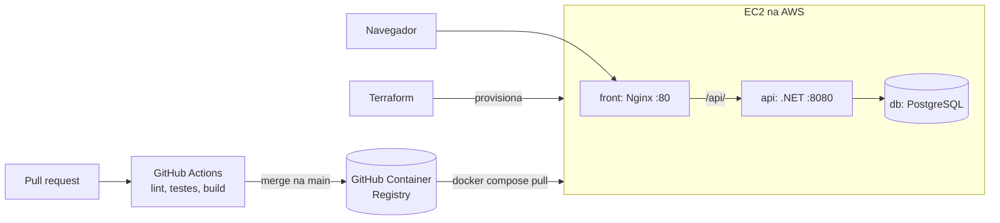

# UserManagement · Infra

Infraestrutura de um projeto de estudo de DevOps: uma aplicação com API .NET, front React e PostgreSQL, levada do código até a **AWS** com containers, integração contínua e **infraestrutura como código**.

## Destaques

- **Docker Compose** para desenvolvimento e para produção
- **Terraform** provisionando EC2, firewall, chave SSH, IP fixo e alerta de custos
- **Imagens versionadas no GitHub Container Registry**, publicadas pelo CI após o merge
- **Ciclo de custo controlado**: `apply` para subir, testar e `destroy` para remover os 8 recursos
- **Segredos fora do Git**: `.env`, `terraform.tfvars` e `terraform.tfstate` não são versionados

## Arquitetura



Só o `front` é exposto. O banco e a API ficam acessíveis apenas dentro da rede do Docker.

| Serviço | Origem | Porta | Função |
|---|---|---|---|
| `db` | `postgres:17-alpine` | interna (5432) | Banco de dados, com volume `pgdata` |
| `api` | UserManagementAPI | interna (8080) | API .NET (login JWT + CRUD de pessoas) |
| `front` | [UserManagement_Frontend](https://github.com/Marcosgt1111/UserManagement_Frontend) | 8080 em dev, 80 em produção | React servido por Nginx, que repassa `/api` para a API |

## Desenvolvimento local

Pré-requisitos: Docker Desktop e os três repositórios clonados lado a lado na mesma pasta.

```bash
cp .env.example .env        # preencha os valores
docker compose up --build
```

Abra http://localhost:8080. Na primeira subida o banco começa vazio, e a API aplica as migrations sozinha.

| Comando | O que faz |
|---|---|
| `docker compose up --build -d` | Sobe em segundo plano |
| `docker compose ps` | Mostra o estado dos containers |
| `docker compose logs -f api` | Acompanha os logs da API |
| `docker compose down` | Para e remove os containers (os dados ficam no volume) |
| `docker compose down -v` | Para tudo e apaga o banco |

## Produção

O [`docker-compose.prod.yml`](docker-compose.prod.yml) usa as imagens prontas do GHCR, então o servidor não precisa do código-fonte. Cada imagem pode ser fixada em uma versão com `API_TAG` e `FRONT_TAG`, usando o SHA do commit.

As imagens são privadas: é preciso fazer `docker login ghcr.io` com um token que tenha `read:packages`.

## Infraestrutura com Terraform

A pasta [`terraform/`](terraform) cria na AWS:

| Recurso | Função |
|---|---|
| EC2 `t3.micro` (Ubuntu 24.04) | Servidor, com disco criptografado e IMDSv2 obrigatório |
| Security Group + 3 regras | Firewall: HTTP e SSH restritos ao IP do operador, saída liberada |
| Key Pair | Acesso SSH |
| Elastic IP | Endereço fixo |
| AWS Budget | Alerta por e-mail ao atingir 80% do limite mensal |

Na primeira inicialização, o [`user_data.sh`](terraform/user_data.sh) instala o Docker e cria 2 GB de swap.

```bash
cd terraform
cp terraform.tfvars.example terraform.tfvars   # preencha seu IP e e-mail
aws login
terraform init
terraform plan
terraform apply
```

Para remover tudo e parar o consumo:

```bash
terraform destroy
```

O banco é apagado junto com a máquina, pois fica no disco da EC2.

## Variáveis de ambiente

| Variável | Uso |
|---|---|
| `POSTGRES_USER` / `POSTGRES_PASSWORD` | Usuário e senha do Postgres, também usados na connection string da API |
| `JWT_KEY` | Chave de assinatura dos tokens JWT (mínimo de 32 caracteres) |
| `API_TAG` / `FRONT_TAG` | Versão das imagens em produção (padrão: `latest`) |

Se uma variável obrigatória estiver faltando, o `docker compose` para com uma mensagem dizendo qual.

## Roadmap

- [x] Containers e Docker Compose
- [x] CI e publicação de imagens no GHCR
- [x] Compose de produção
- [x] Infraestrutura na AWS com Terraform
- [x] Deploy na EC2, feito manualmente
- [ ] CD automatizado com GitHub Actions
- [ ] Autenticação real na API (hoje o login é de demonstração) e HTTPS
